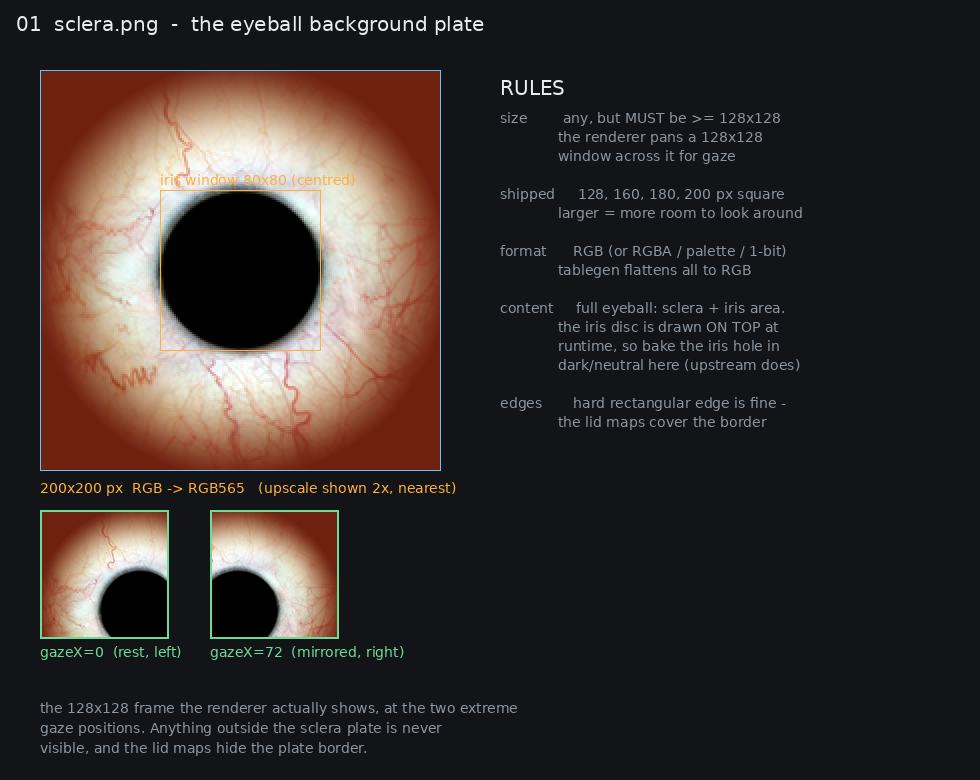
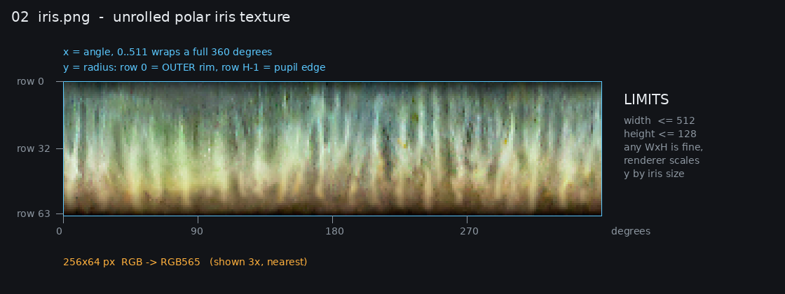
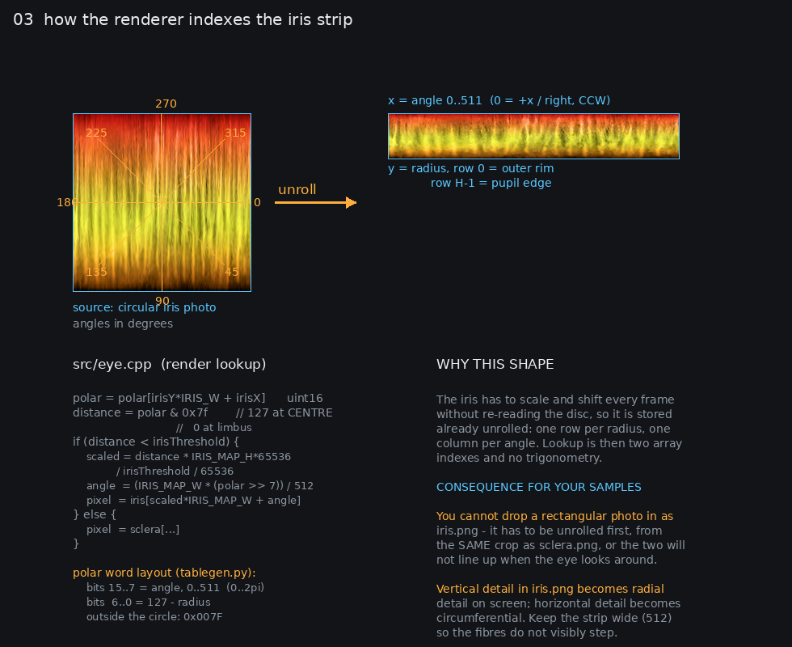
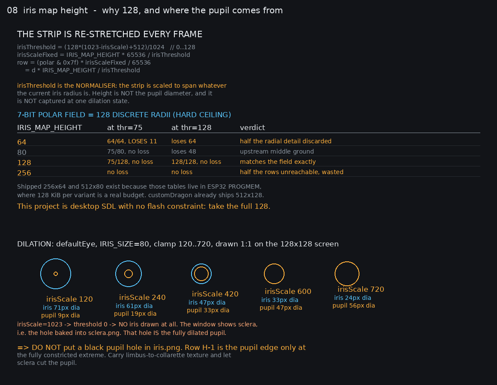
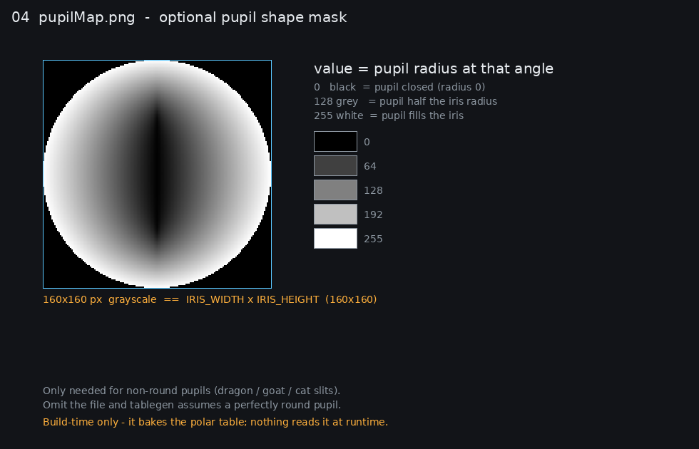
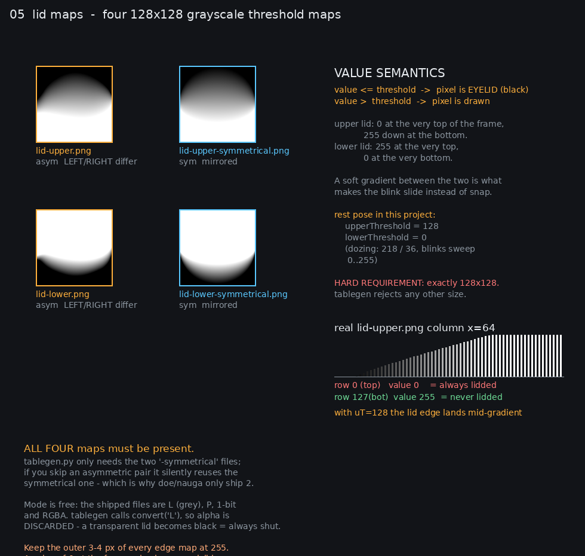
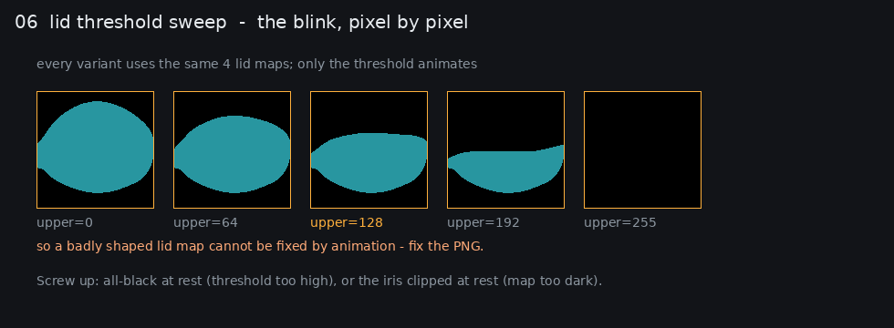
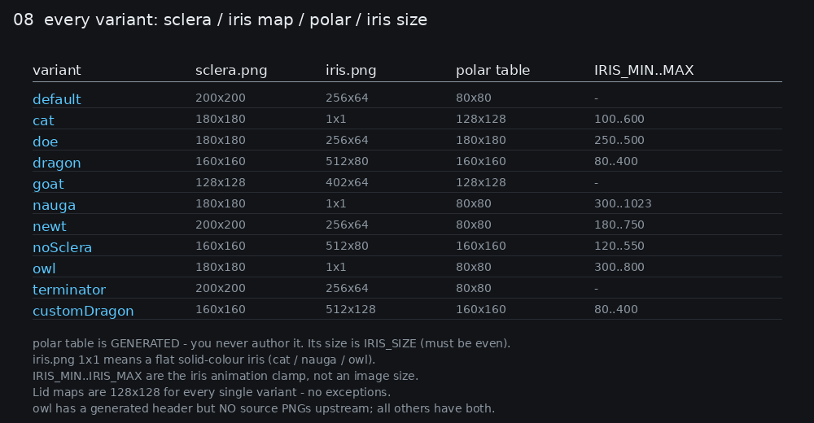
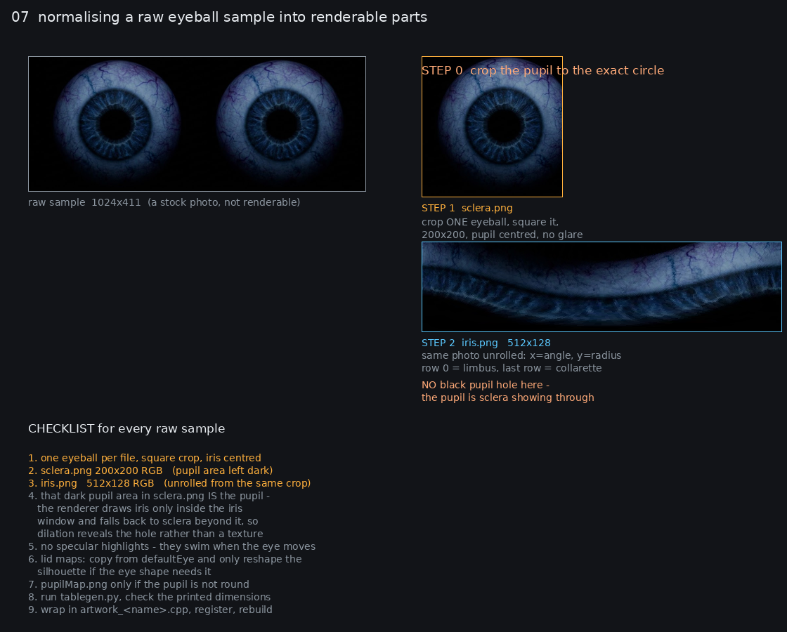

# EYE ASSET SPEC — what this system expects from an eye

Authoritative reference for turning eyeball samples into renderable variants.
Every rule below was read out of the actual code, not guessed:

| fact | source of truth |
|---|---|
| per-pixel render order, index math | `src/eye.cpp` (`EyeRenderer::render`) |
| runtime struct the parts feed | `src/eye.h` (`EyeArtwork`) |
| PNG → C array conversion, all limits | `Uncanny_Eyes/convert/tablegen.py` |
| shipped source art | `Uncanny_Eyes/convert/<variant>/*.png` |
| generated arrays | `Uncanny_Eyes/uncannyEyes/graphics/<variant>.h` |
| design registration | `src/artwork_registry.cpp`, `src/artwork.h`, `CMakeLists.txt`, `uncanny-tui.py` |

---

## 0. TL;DR — the five files

Put these in a folder per variant:

```
<variant>/
  sclera.png                    REQUIRED   eyeball plate,      >= 128x128, square
  iris.png                      REQUIRED   unrolled iris,      <= 512 x 128
  lid-upper.png                 REQUIRED   lid threshold map,  EXACTLY 128x128
  lid-lower.png                 REQUIRED   lid threshold map,  EXACTLY 128x128
  lid-upper-symmetrical.png     optional   lid threshold map,  EXACTLY 128x128
  lid-lower-symmetrical.png     optional   lid threshold map,  EXACTLY 128x128
  pupilMap.png                  optional   pupil shape,       IRIS_SIZE square
```

Everything else in the pipeline is **generated** — you never author the polar
table, the C arrays, the `#define`s, or the `artwork_*.cpp` by hand.

---

## 1. `sclera.png` — the eyeball plate



| | |
|---|---|
| size | **must be >= 128x128.** The renderer pans a fixed 128x128 window across it for gaze. Shipped sizes are 128, 160, 180, 200 px square. Larger = more room to look around. |
| format | RGB. `RGB`/`RGBA`/palette/`1`-bit all work — `tablegen` calls `convert('RGB')`, so **alpha is discarded**. |
| content | The whole eyeball: sclera + the iris area. The iris disc is composited on top at runtime, so the iris region here should be dark/neutral. Upstream leaves a black hole; that is correct and it hides any misalignment. |
| iris window | centred: `irisX = scleraX + x - (SCLERA_WIDTH - IRIS_WIDTH)/2`. The polar table is centred on the plate — do not offset the pupil in your crop. |
| edges | hard rectangular edges are fine, the lid maps cover the border. Keep the outer few px dark so nothing pops at extreme gaze. |

## 2. `iris.png` — the unrolled iris



| | |
|---|---|
| size | **<= 512 wide, <= 128 tall.** `tablegen` hard-errors above either. **Use 512x128 for new work** — see §2.1 for why that is the ceiling and why upstream ships smaller. |
| format | RGB → RGB565. RGBA is accepted but alpha is dropped, so pre-composite onto black. |
| x axis | **angle**, 0..511 wraps a full 360°. `angle = (IRIS_MAP_WIDTH * (polar >> 7)) / 512`. Column 0 is +x / 3 o'clock, increasing counter-clockwise in image terms. |
| y axis | **radius**. Row 0 = **outer rim** (limbus), row H-1 = **inner edge** — the pupil edge only at the fully constricted extreme, see §2.1. |



The polar word (generated, 16-bit) is `(angle << 7) | (127 - radius)`; `0x007F`
marks everything outside the circle. Extracted distance `d = polar & 0x7f` is
**127 at the centre and 0 at the limbus** (verified against the real
`defaultEye.h` table: centre `0xA07D` → d=125, near-rim `0xBF01` → d=1). A pixel
is iris when `d < irisThreshold`, so small `d` near the rim is iris and large `d`
toward the centre falls through to sclera.

**Unrolled from the same crop as `sclera.png`, or the two will not line up when
the eye looks around.** Vertical detail in the strip becomes radial detail on
screen; horizontal detail becomes circumferential. Keep it 512 wide or the iris
fibres visibly step.

### 2.1 Why 512x128, and where the pupil actually comes from



**The strip is a normalised radial axis, re-stretched every frame.** Its height
is *not* the pupil diameter and is not captured at any particular dilation.
`src/eye.cpp` now uses the calibrated ratio model:

```cpp
// The pupil radius is derived from:
// pupilRatio = Rmin + D * (Rmax - Rmin)
// pupilRadius = limbusDiameter * pupilRatio / 2
// where D is the normalized dilation (0..1)

// The iris threshold maps back into the existing polar sampling:
irisThreshold = clamp(irisRadius - pupilRadius_pixels, 0, irisRadius * 2)
```

The pupil boundary is now derived from:
1. **Eye calibration** (`EyeCalibration` in `src/eye.h`): limbus diameter, Rmin/Rmax ratios, fixed center
2. **Normalized dilation** (0..1): from LDR sensor or other input
3. **Existing polar sampling**: iris/sclera cutoff at the calibrated boundary

At minimum dilation (D=0), the pupil uses Rmin. At maximum dilation (D=1), it
uses Rmax. The threshold calculation converts the calibrated pupil radius into
the threshold value the polar sampler understands, preserving the existing
render path.

**The pupil is not in your strip — it is the hole in `sclera.png`.** Pixels with
`d >= irisThreshold` fall back to sclera:

```
if (distance < irisThreshold) { source = iris[...]; }
else                         { source = sclera[...]; }
```

The calibrated pupil boundary determines the cutoff, so the sclera show-through
remains the pupil shape — just now with a properly constrained ratio.

> **So: do not put a black pupil hole in `iris.png`.** Row `H-1` is the pupil
> edge only at the fully constricted extreme. The strip should carry
> limbus-to-collarette texture and let sclera cut the pupil.

**128 is the ceiling.** The polar field packs distance into 7 bits — 128
discrete radii — so no height above 128 addresses anything extra:

| `IRIS_MAP_HEIGHT` | threshold=75 | threshold=128 | verdict |
|---|---|---|---|
| 64 | 64/64 rows, **loses 11 radii** | loses 64 radii | half the radial detail discarded |
| 80 | 75/80, no loss | loses 48 | upstream's middle ground |
| **128** | 75/128, no loss | 128/128, no loss | **matches the field exactly** |
| 256 | no loss | no loss | half the rows unreachable, wasted |

Upstream ships 256x64 (four variants) and 512x80 (two) because those tables live
in **ESP32 PROGMEM** — 128 KiB per variant is a real budget there.
`customDragon` already ships 512x128, so there is precedent. This project is
desktop SDL with no flash constraint, so take the full 128.

## 3. `pupilMap.png` — pupil shape (optional)



| | |
|---|---|
| size | exactly `IRIS_SIZE` square (160x160 for dragon/goat, 128x128 for cat). `tablegen` errors on a mismatch. |
| format | grayscale. Value = pupil radius at that angle: `0` = closed, `255` = fills the iris. |
| when | only for non-round pupils (dragon slit, goat, cat). Omit the file and a perfectly round pupil is assumed. |
| note | **build-time only.** It is baked into the polar table; nothing reads it at runtime. |

> ### ⚠ Do not use `pupilMap.png` — it is degenerate
>
> It does **not** produce a shaped pupil. It replaces the polar table's radial
> distance field with a purely *angular* one:
>
> ```
> d(theta) = 127 - int(map(theta)/255 * 128)
> iris where d < irisThreshold
> ```
>
> The iris strip is indexed by `(distance, angle)`. Once distance no longer
> varies with radius, **every pixel at a given angle samples one single row of
> the strip** — the 128-row texture collapses to 1 row per angle and renders as
> radial spokes. The pupil also becomes an angular wedge rather than a bounded
> shape, so a compact disc pupil is impossible through this path.
>
> Proof: upstream `dragonEye` ships a `pupilMap.png`. Rendered, it is a
> crescent of iris with a huge black pupil and visible radial streaking.
>
> **For a shaped pupil use `EyeArtwork::pupilShape` instead** — see §3.1.

## 3.1 Shaped pupils — `EyeArtwork::pupilShape`

Because `pupilMap.png` cannot express one (above), shaped pupils are a renderer
feature. Two fields are used at the **end** of `EyeArtwork` in `src/eye.h`:

```cpp
int    pupilShape = 0;   // 0 = round (default), 1 = vertical slit, 2 = horizontal
double slitRatio  = 0.0; // short semi-axis as a fraction of the long one
EyeCalibration pupilGeometry{}; // limbus diameter, Rmin/Rmax, center
```

They are default-initialised, so every `artwork_*.cpp` that lists fewer members
keeps the previous round-pupil behaviour untouched. A variant opts in by
appending the values after `irisMax`:

```cpp
    120,
    720,
    1,      // vertical slit
    0.26,   // short/long ratio
    EyeCalibration{100.0F, 0.12F, 0.42F, 100.0F, 100.0F},  // pupilGeometry
};
```

How it works in `src/eye.cpp`: the iris still spans the polar circle out to
`irisThreshold`, but the **pupil test is replaced outright** rather than added
to — the pupil ellipse's long axis is set to the calibrated radius derived from
the pupil-to-limbus ratio model, so a slit occupies the same overall size as the
round pupil it replaces and widens as the eye dilates.

The calibrated pupil boundary is computed via:
- `pupilRadiusFromCalibration()` — derives pupil radius from dilation and EyeCalibration
- `dilationToPupilRatio()` — interpolates Rmin to Rmax based on normalized dilation

Two traps, both hit during implementation:

- The iris is bounded by the **polar circle**, not by the threshold. Deriving the
  extent from `irisThreshold` lets texture spill outside the circle into a
  rounded square.
- At `irisScale == 1023` the threshold collapses to `0`. If the pupil test is
  skipped on that path the code samples the strip at `distance = 127`, which
  indexes past the array and segfaults. `scaledDistance` is clamped as a backstop.

Verified by md5: rendering all eight variants before and after this change leaves
the seven non-slit variants **byte-identical**.

## 4. `lid-*.png` — the four eyelid maps



| | |
|---|---|
| size | **EXACTLY 128x128.** `tablegen` rejects anything else with "Image size must match screen size". This is the one non-negotiable rule. |
| format | grayscale. `L`/`P`/`1`-bit/`RGBA` all fine — `convert('L')` means **alpha is discarded**, so a transparent lid becomes black = permanently shut. |
| semantics | `value <= threshold` → the pixel is **eyelid** (rendered black). `value > threshold` → drawn. |
| orientation | upper: `0` at the very top of the frame → `255` at the bottom. lower: `255` at the top → `0` at the bottom. |
| gradients matter | a soft ramp between the two is what makes the blink *slide*. A hard 0/255 edge gives a snapping blink. |
| thresholds | rest `upper=128, lower=0`; dozing `218 / 36`; blinks sweep `0..255`. |



- All four files are needed for a **complete** variant. `tablegen` reads the
  `-symmetrical` pair into the `#ifdef SYMMETRICAL_EYELID` branch and the
  asymmetric pair into the `#else` branch, so if you only want one lid shape
  pass the same file in both slots.
- Shipped precedent: `default`/`cat`/`dragon`/`goat`/`newt`/`noSclera`/
  `terminator`/`customDragon` all ship four; `doe` ships two (identical in both
  branches); `nauga` ships two *and* has no `#ifdef` at all in the generated
  header, so its `artwork_*.cpp` points the symmetric and asymmetric pointers at
  the same arrays. Both are legitimate — just be deliberate.
- Keep the outer 3–4 px of every edge map at `255`. A `0` at the frame edge
  leaves a visible gap between lid and bezel when the eye looks to the corner.

## 5. All variants at a glance



`IRIS_MIN..IRIS_MAX` is the iris **animation clamp** (0..1023 scale where larger
= bigger iris), not an image dimension. `iris.png` of `1x1` means a flat
solid-colour iris (cat / nauga / owl).

Note that `owl` has a generated header in
`Uncanny_Eyes/uncannyEyes/graphics/owlEye.h` but **no source folder** in
`Uncanny_Eyes/convert/` — upstream never published its PNGs. Everything else in
that table has both. `terminatorEye`'s lid maps ship as 1-bit, which is a useful
reminder that grayscale source mode is free.

---

## 6. Colour format — RGB565, all colour parts

Both `sclera.png` and `iris.png` are packed by `tablegen` as:

```python
((r & 0b11111000) << 8) | ((g & 0b11111100) << 3) | (b >> 3)   # 5/6/5 bits
```

and unpacked by `src/eye.cpp:rgb565ToRgba` as `r5 = v>>11`, `g6 = (v>>5)&0x3f`,
`b5 = v&0x1f`, expanded `<<3|>>2` and `<<2|>>4`.

Practical notes:
- no alpha anywhere in the colour path
- gradients and iris fibres band slightly; that is inherent to RGB565
- the `polar` table and the lid maps are **not** RGB565 — `polar` is a packed
  angle/distance word, lids are raw 8-bit

---

## 7. Normalising a raw sample



For every file dropped in `create/raw/`:

1. **one eyeball per file**, square crop, iris dead-centre, no specular highlight
2. `sclera.png` → 200x200 RGB, pupil area flattened dark
3. `iris.png` → 512x128 RGB, unrolled from *the same crop*
4. lid maps → copy `defaultEye`'s, reshape only if the eye shape demands it
5. `pupilMap.png` only if the pupil is not round
6. run `tablegen.py`, sanity-check the printed dimensions
7. wrap in `artwork_<name>.cpp`, register, rebuild

Your current `create/raw/` samples are 1024x411 and 1634x656 stock photos with
**two** eyeballs in frame — they need step 1 before anything else.

### Generating the parts

```bash
cd Uncanny_Eyes/convert/<variant>

# positional args (all optional, defaults shown):
#  1 sclera.png  2 iris.png
#  3 lid-upper-symmetrical.png  4 lid-lower-symmetrical.png
#  5 lid-upper.png              6 lid-lower.png
#  7 IRIS_SIZE (even, default 80)  8 pupilMap.png
python3 ../tablegen.py > ../../../src/generated/<variant>Eye.h
```

`IRIS_SIZE` must be **even** (it is the polar table side) and must equal the
`pupilMap.png` size. `IRIS_SIZE` larger than `SCLERA_SIZE` is pointless — the
iris window would fall outside the plate.

---

## 8. Wiring a new variant into the TUI

Five edits, all mechanical:

1. `src/generated/<name>Eye.h` — the `tablegen` output
2. `src/artwork_<name>.cpp` — copy `src/artwork_default.cpp`, swap the include
   and the `EyeArtwork` name string
3. `src/artwork.h` — add `const EyeArtwork& <name>EyeArtwork();`
4. `src/artwork_registry.cpp` — add it to the `artworkList()` vector
5. `CMakeLists.txt` — add the `.cpp` to `add_executable`

**The TUI needs no edit at all.** `uncanny-tui.py` discovers the variant list at
startup by running `uncanny-eyes --list-designs`, which prints straight from the
registry, and offers each variant as a two-digit selector:

```
  ── Variants ──
    01  default
    02  cat
    03  dragon          <-
    04  customDragon
```

Type the number (`07` or a bare `7` both work) or the design name / a unique
prefix. Selection is line-based `input()` — no curses, no arrow keys. Restart the
TUI after a rebuild to pick up new variants.

`--design` names are matched case-insensitively against `EyeArtwork::name`.

### The one gotcha in the generated header

`tablegen` emits the *same* symbol names for every variant: `sclera`, `iris`,
`upper`, `lower`, `polar`. Two variants in one translation unit collide. Each
`artwork_*.cpp` includes exactly one generated header, so this only bites when
you rename — the custom dragon variants solve it by renaming the iris array
(`iris_dragonA`) by hand after generation.

Also note the generated header contains `#ifdef SYMMETRICAL_EYELID` with two
copies of `upper`/`lower`. Both copies end up in the object; the preprocessor
picks one. Only relevant if you port this back to Arduino.

---

## 9. Pre-flight checklist

- [ ] `sclera.png` >= 128x128, pupil centred, iris area dark
- [ ] `iris.png` **512x128**, x = angle, **row 0 = outer rim**
- [ ] `iris.png` has **no black pupil hole** — the pupil is sclera showing through
- [ ] `iris.png` unrolled from the same crop as `sclera.png`
- [ ] all four lid maps **exactly 128x128**
- [ ] lid edges: outer 3–4 px at 255, gradient not a hard step
- [ ] `pupilMap.png` (if present) exactly `IRIS_SIZE` square
- [ ] `IRIS_SIZE` even, and `<= SCLERA_SIZE`
- [ ] `tablegen` printed dimensions match the intent
- [ ] `EyeArtwork::irisMin`/`irisMax` set to the intended animation range
- [ ] `EyeArtwork::pupilGeometry` calibrated for this eye (limbus diameter, Rmin/Rmax)
- [ ] registered in `artwork.h` + `artwork_registry.cpp` + `CMakeLists.txt`
- [ ] reachable from the TUI automatically (it reads `--list-designs`; just restart it)
- [ ] rendered at `--design <name>` and eyeballed at rest, mid-blink, and at
    both horizontal gaze extremes

---

## 10. Eye calibration — normalized pupil-to-limbus ratio model

### 10.1 Calibration data

Every `EyeArtwork` now carries an `EyeCalibration` struct that defines the
eye-specific geometry used by the ratio-based pupil model:

```cpp
struct EyeCalibration {
    float limbusDiameter = 100.0F;  // eye-specific diameter in normalized canvas units (200x200)
    float pupilRatioMin = 0.12F;   // Rmin for D = 0.0
    float pupilRatioMax = 0.42F;   // Rmax for D = 1.0
    float pupilCenterX = 100.0F;   // fixed center
    float pupilCenterY = 100.0F;   // fixed center
};
```

### 10.2 Normalized ratio model

The pupil boundary is computed as:

```text
D = clamp(dilation, 0.0, 1.0)
pupilRatio   = Rmin + D × (Rmax - Rmin)
pupilDiameter = limbusDiameter × pupilRatio
pupilRadius   = pupilDiameter / 2
```

- `D` is the normalized dilation from LDR sensor or other input (0.0 = fully
  constricted, 1.0 = fully dilated)
- `limbusDiameter` provides the absolute scale
- `pupilRatioMin`/`pupilRatioMax` bound the pupil-to-limbus ratio
- The fixed center `(100, 100)` is invariant under all dilation states

### 10.3 Separation of concerns

- **Source artwork** (this document): provides `limbusDiameter`, `Rmin`, `Rmax`
- **LDR sensor** (`LDRSerialInput.cpp`): provides normalized dilation (0.0 → 1.0)
- **Runtime renderer** (`eye.cpp`): combines them to compute the pupil boundary,
  then uses the existing polar sampling path

### 10.4 Integration point

The `EyeCalibration` is a field of `EyeArtwork` and is applied during animation
in `EyeAnimator::update()`, which computes `pupilRadius` via
`pupilRadiusFromCalibration()` and passes it through `RenderInput` to the
renderer. The renderer keeps its existing polar iris/sclera reveal path — only
the cutoff boundary changes from the raw `irisScale` threshold to the calibrated
ratio-derived radius.